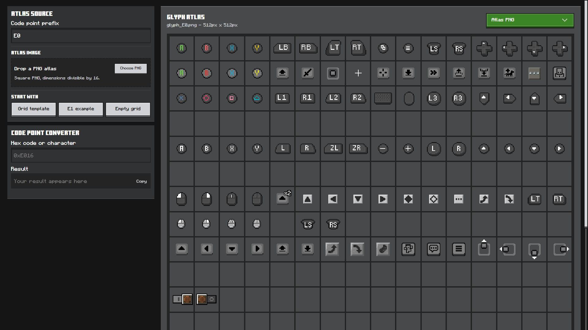

# Glyph Tools

Create, inspect, and edit Minecraft Bedrock glyph atlases in your browser.

**[Open Glyph Tools](https://nhanaz.github.io/glyph/)**



## Use the editor

1. Load a preset or upload a PNG atlas. A filename such as `glyph_E0.png` selects the `E000` to `E0FF` range. Other filenames prompt for a prefix.
2. Select a cell to inspect its character, code point, position, and dimensions. Replace it with a PNG or bundled Minecraft texture, or clear it.
3. Download the edited atlas or export characters, a reference map, or metadata JSON. The bitmap font JSON export uses the Java Edition format.

The converter translates between hexadecimal code points and characters. Atlases use a 16 by 16 grid with 256 cells.

## Run in development

Use Node.js 22 or newer. Install dependencies and start Vite.

```bash
npm ci
npm run dev
```

Open [localhost:5173/glyph](http://localhost:5173/glyph/).

## Validate and build

```bash
npm run check
npm run build
```

Vite writes a static site to `dist`. GitHub Pages publishes that folder. The app does not need a server side runtime.

## Refresh the Minecraft texture library

Textures are bundled in the repository. To refresh them from [Mojang Bedrock Samples](https://github.com/Mojang/bedrock-samples/tree/main/resource_pack/textures), use Node.js and Git.

```bash
node scripts/fetch-vanilla.js
```

The script rebuilds `vanilla-textures/manifest.json` and replaces the library after the new files are ready.

## Design and licenses

The interface draws on Mojang's Ore UI. It uses React Facet, the open source state and rendering package published in the [Mojang Ore UI repository](https://github.com/Mojang/ore-ui), for the live glyph selection readout. The workspace styles and controls are part of this project.

Glyph Tools source is licensed under [GPL-3.0](LICENSE). React, React Facet, and Vite are MIT licensed. Bundled Minecraft textures remain subject to the [Minecraft End User License Agreement](https://www.minecraft.net/eula).
