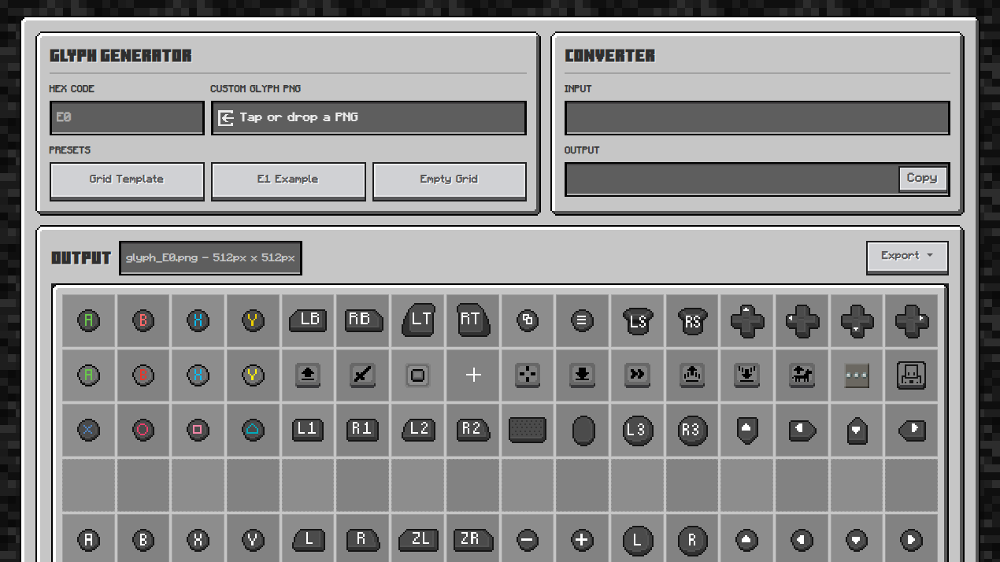

# Glyph Tools

Create, inspect, and edit Minecraft glyph atlases in your browser.

**[Open Glyph Tools](https://nhanaz.github.io/glyph/)**



## Usage

1. Load a preset or upload a PNG atlas. A filename such as `glyph_E0.png` selects the `E000`–`E0FF` range; other filenames prompt for a prefix.
2. Select a cell to inspect its character, code point, position, and dimensions. Replace it with a PNG or a bundled Minecraft texture, or clear it.
3. Download the edited atlas or export characters, a reference map, or metadata JSON. The bitmap font JSON export uses the Java Edition format.

The converter also translates between hexadecimal code points and characters. Atlases use a 16 × 16 grid with 256 cells.

## Run locally

Serve the repository over HTTP so the bundled texture picker can load its manifest.

```bash
python -m http.server 8000
```

Open [localhost:8000](http://localhost:8000/) in a browser. There is no build step.

## Refresh the Minecraft texture library

Textures are bundled in the repository. To refresh them from [Mojang Bedrock Samples](https://github.com/Mojang/bedrock-samples/tree/main/resource_pack/textures), use Node.js and Git:

```bash
node scripts/fetch-vanilla.js
```

The script rebuilds `vanilla-textures/manifest.json` and replaces the library after the new files are ready.

## Development

With Node.js 22 or newer:

```bash
npm ci
npm run check
```

This runs syntax checks, ESLint, and the tests.

## License

Source code: [GPL-3.0](LICENSE).

Minecraft textures remain subject to the [Minecraft End User License Agreement](https://www.minecraft.net/eula).
